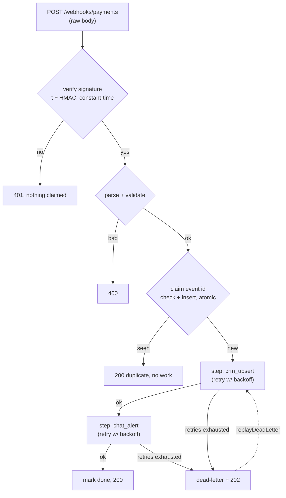

# Design notes

How the pipeline stays correct when things go wrong, and — the part that matters
most for real money — the failure model, including what it does **not** handle.

## The shape



## Exactly-once *effects* on an at-least-once channel

A provider retries until it gets a 2xx, so the same event arrives more than once.
Two mechanisms make the effects happen once:

1. **Claim.** The first delivery inserts an event record; the check and the insert
   are one synchronous block, so two simultaneous deliveries cannot both win (the
   database equivalent is a unique key with `INSERT … ON CONFLICT DO NOTHING`). A
   later delivery gets `200 duplicate` and runs nothing.
2. **Per-step checkpoints.** The two side effects — `crm_upsert`, then
   `chat_alert` — are recorded as they succeed. A replay skips the steps already
   marked, so a half-finished event finishes instead of starting over.

## The crash window, and why step order is deliberate

There is a gap between an effect succeeding and its checkpoint being written:

```
await withRetry(() => perform(step, event));  // the side effect happened
deps.store.markStep(event.id, step);          // <-- a crash here loses the checkpoint
```

If the process dies in that gap, the step is *not* recorded, so a later replay
runs it again. That means **every step must be safe to run twice**:

- `crm_upsert` is idempotent — it is keyed on the customer email, so a second
  upsert with the same data is a no-op on the CRM side.
- `chat_alert` is **not** idempotent — posting the same message twice posts it
  twice. So it is deliberately ordered **last**: the only step that can double on a
  crash is the cheapest to double (a duplicate chat line, not a duplicate CRM
  write). A production version would give the chat post its own idempotency key so
  even that can't double.

This ordering is the whole design, not an accident: put the idempotent, expensive
effects first and the non-idempotent, cheap one last.

## Dead-letter, and why it answers 202

When an outbound call exhausts its retries, the event, the failing step, the
attempt count and the last error are recorded, and the webhook returns **202**, not
a 5xx. A 5xx would make the provider resend the event — but the event is already
*ours*: it is recorded and replayable. Asking for a resend would only create a
second copy of work we already own. A person (or a sweep) calls
`replayDeadLetter(eventId)`, which resumes from the failed step.

## Retries

`withRetry` tries up to `attempts` times with exponential backoff (sleep is
injected, so tests run instantly and assert the exact schedule). An error marked
`PermanentError` — a 400, an auth failure — is not retried; it dead-letters on the
first try, because retrying it would only waste time.

## Signatures

`t=<unix>,v1=<hex HMAC-SHA256 of "<t>.<raw body>">`. The timestamp is inside the
signed material, so an old delivery cannot be replayed with a fresh header; the
check rejects anything outside a ±300s window, compares in constant time, and
accepts several `v1` values so a secret can be rotated without dropping events. It
runs on the **raw received bytes** — the body is never re-serialised before
verification, because re-serialising would change the bytes and break the HMAC.

## Failure model — and what this does NOT handle

| Failure | Handled by |
|---|---|
| Forged / tampered / missing / stale-timestamp request | Signature check; nothing is claimed |
| Duplicate or concurrent delivery | Atomic claim → `200 duplicate` |
| Transient outbound failure (timeout, 503) | Retry with backoff |
| Permanent outbound failure (400, auth) | Dead-letter on first try |
| Half-finished event (CRM ok, chat failed) | Per-step checkpoints; replay skips CRM |

What it does **not** handle (documented, not hidden):

- **Durability.** The store is in memory, so a restart loses everything. A real
  deployment is a database table with a unique key on the event id.
- **A mid-processing crash orphans the event.** If the process dies after claiming
  but before finishing, the record is stuck in `processing`, and a provider retry
  is acknowledged as a duplicate — so the work is never completed *and* never
  retried. The fix is a lease: a sweep that reclaims `processing` rows older than a
  timeout and replays them. This repo records the state but does not run the sweep.
- **A non-idempotent step can double on a crash** (the chat alert — see above);
  closing that fully needs a per-message idempotency key on the chat side.
- **Volume.** Steps run inline, one event at a time, one event type. At higher
  volume a queue and workers replace the inline calls; the per-step checkpoint
  model carries over unchanged.

## Testing

`test/` runs under `node:test` with no services, and typechecks under `strict`
TypeScript in CI on Node 22 and 24. The suite was checked by *removing* each
safeguard — the step skip, the de-duplication, the signature check, the backoff —
one at a time and confirming the matching tests turn red.
